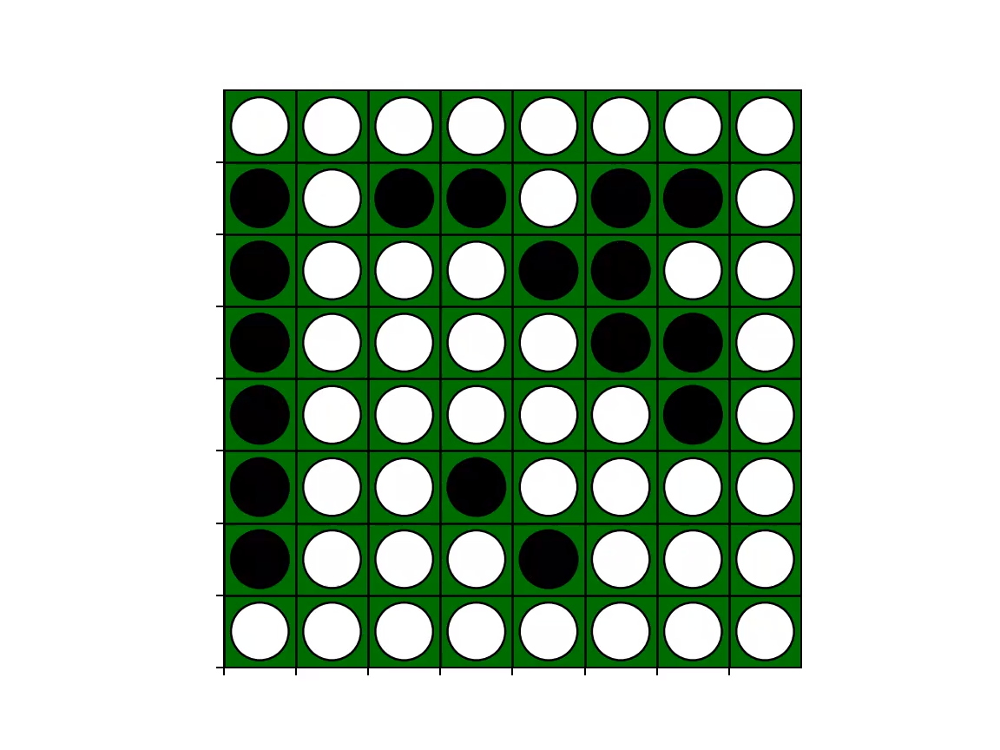

# BetaOthello

An Othello agent whose action-value function is a Bayesian neural network, trained from self-play.

The network's weights are Gaussian distributions learned by variational inference, so every Q-value the agent computes is a draw from a posterior over value functions instead of a single point estimate. The project was a way to work through stochastic variational inference end to end (ELBO, KL term, reparameterised sampling) on a problem with a real decision loop attached.



Built by Shubham Singh and Narendra Gangwani as a statistics course project at UT Dallas, Spring 2023.

## How it works

### The game

`othello.py` implements the full rules. A position is a `3 x 8 x 8` integer array holding a white plane, a black plane, and a turn plane filled with the index of the player to move. Black moves first. `validAction` scans the eight directions from every empty square to find legal moves, `applyAction` places a disc and flips the captured lines, and a pass is encoded as `(-1, -1)`. `viz` draws the board with matplotlib and marks the legal moves with dashed circles.

### The value network

`bnn.py` defines Q(s, a) as a regression network. The input is the position stacked with a one-hot plane for the candidate move (`4 x 8 x 8`), flattened and passed through two `DenseVariational` layers of 128 and 32 units with ReLU, then a single linear output.

Each variational layer keeps a mean-field Gaussian posterior over its weights, with a learned mean and a softplus-parameterised scale. The prior is a unit-variance Gaussian with a trainable mean. Training minimises squared error plus the KL divergence from posterior to prior, weighted by one over the batch size, which is the negative ELBO under a Gaussian likelihood up to scaling.

### Training

`qlearnng.py` and `train.py` run the learning loop.

1. The agent plays a full game against itself with an epsilon-greedy policy (epsilon = 0.1).
2. Every move is labelled with the final outcome from the mover's side, `own discs / (opponent discs + 0.1) - 1`, and stored in a replay buffer of the 1,000 most recent transitions.
3. A batch of 32 transitions is sampled and the network is fitted to it for 10 epochs with Adam.

`train.py` repeats this 100 times. The regression target is the Monte Carlo return of the finished game. There is no bootstrapped TD target yet, so the `gamma` and target-network arguments in the `QLearning` class are placeholders for that step.

### Choosing a move

At play time the agent scores every legal move and takes the highest. Each score comes from a fresh sample of the network's weights, so move choice already carries some posterior randomness on top of epsilon-greedy. That's close in spirit to Thompson sampling, though the weights are resampled per move instead of once per decision.

## Running it

The code was written on Python 3.10 with TensorFlow 2 and TensorFlow Probability. The variational layers depend on Keras 2, so use a TensorFlow release before 2.16.

```bash
git clone https://github.com/sudoberlin/BetaOthello.git
cd BetaOthello
pip install -r requirements.txt
python train.py
```

`train.py` trains the agent from scratch and prints the loss for each fit. A self-play game takes a few tens of seconds on CPU, because every candidate move is a separate forward pass.

To play against the agent, open `StatsProject/othello.ipynb`, run the cells in order, and enter your move as `row col` (zero-indexed, for example `2 3`) when prompted. You play black and move first. The notebook also assembles the game into a video.

## Repository layout

| Path | Contents |
| --- | --- |
| `othello.py` | Game rules, state representation, board rendering |
| `bnn.py` | Bayesian network, prior and posterior, batch preparation, fitting |
| `qlearnng.py` | Epsilon-greedy policy, self-play, replay buffer |
| `train.py` | Training script |
| `play.py`, `library.py` | Shared imports, the interactive loop currently lives in the notebook |
| `StatsProject/othello.ipynb` | The whole project in one notebook, including human vs agent play |
| `StatsProject/BriefReport.pdf` | Short written report |
| `StatsProject/Presentation1.pptx` | Slides covering the variational inference background |
| `StatsProject/demo.mp4`, `demo.png` | Recorded game and a board snapshot |

## Status

This is a one-semester prototype. It trains from self-play and plays complete, legal games against a human, which is what the demo shows. It has been trained for 100 self-play games and has not been benchmarked against a random or greedy baseline, so the repo makes no claim about playing strength.

What comes next, in order:

1. Replace the Monte Carlo target with a bootstrapped TD target and a target network.
2. Bring the Adam learning rate down from 0.1 and track the loss across training.
3. Add an evaluation script that reports win rate against random and greedy-flip opponents.
4. Save trained weights and move the interactive game into `play.py`.
5. Use the posterior directly for exploration (Thompson sampling or an uncertainty bonus) and compare it with epsilon-greedy.
6. Swap the flattened input for convolutional layers.

## Demo

https://github.com/sudoberlin/BetaOthello/assets/45774470/69656d6b-8c99-4836-be63-573ed0f77328

## Authors

Shubham Singh and Narendra Gangwani
